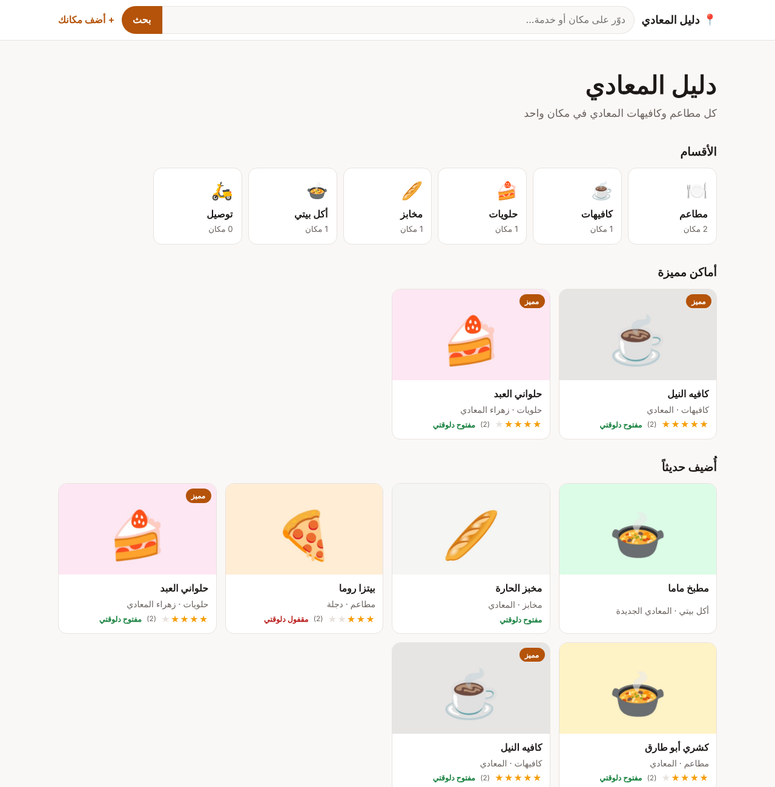
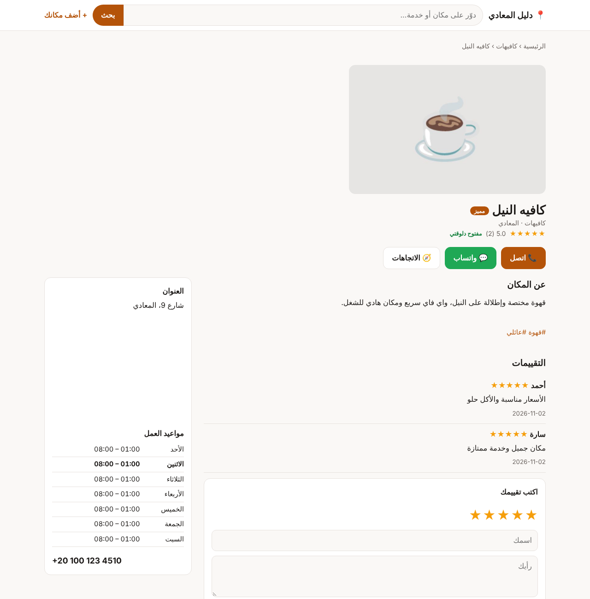
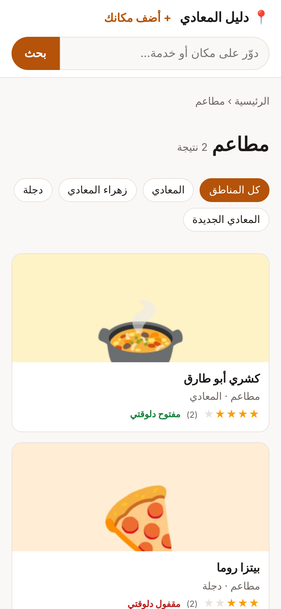

<div align="center">

# Daleel · دليل

**Build a directory website for places and services.**
A guide to the restaurants in your city, the clinics in your area, home-service workers, or wedding vendors. Listings with photos, opening hours, map, call and WhatsApp buttons, reviews, and pages built to rank on Google. Open source, self-hosted, no monthly fees.

[](https://www.hostinger.com/docker-hosting?compose_url=https://raw.githubusercontent.com/mashraf1997/daleel/main/docker-compose.yml&REFERRALCODE=YOUR_REFERRAL_CODE)

[English](#what-you-get) · [العربية](#بالعربي)



</div>

---

## What you get

**For visitors**
- Search that understands Arabic spelling (أ/ا, ة/ه, ى/ي) and English.
- Categories and areas, with an **Open now** badge from each place's hours.
- Listing pages with photos, description, hours, address, map, and **Call**, **WhatsApp** and **Directions** buttons.
- Star ratings and reviews.
- An **Add your place** form, so the directory grows by itself.

**For search engines**
- Every page is rendered on the server: fast, and readable without JavaScript.
- `schema.org` structured data per listing (LocalBusiness and the right subtype, opening hours, geo, ratings), canonical links, Open Graph, `sitemap.xml` and `robots.txt`.
- Clean Arabic URLs such as `/l/كافيه-النيل`.

**For you, the directory owner**
- Start from a template: restaurants and cafés, clinics, home services, wedding vendors, or general.
- Add listings by hand, paste a Google Maps link to set the location, or **import a CSV**.
- Approve visitor submissions and reviews before they go live. Spam is filtered with a honeypot and rate limits.
- **Featured listings** shown first with a badge until the date you set. Sell them to the businesses in your directory.
- Stats per listing: views, calls, WhatsApp chats and direction requests. Show businesses the leads you send them.

<p align="center">
  
  
</p>

## Deploy

**One click:** press **Deploy on Hostinger** above, open `http://YOUR-SERVER-IP/admin` and create your directory. Point a domain at the server for Google.

**Docker:**

```bash
git clone https://github.com/mashraf1997/daleel.git && cd daleel
docker compose up -d
```

**Node.js 20+:** `npm start`. No dependencies.

| Variable | Default | Purpose |
|---|---|---|
| `PORT` | `3000` | HTTP port |
| `DATA_DIR` | `./data` | Listings in `daleel.json` and photos in `media/`. Back it up. |
| `SETUP_TOKEN` | *(empty)* | Required to create the first admin when set |
| `DEMO_MODE` | `false` | `true` makes this a public demo: sample data, a reset every hour, and settings that reach outside (tokens, keys, password) locked |
| `DEMO_PASSWORD` | `demo1234` | Password shown on the demo sign-in screen |
| `DEMO_RESET_MINUTES` | `60` | How often the demo data resets (minimum 5) |
| `DEMO_LANG` | `ar` | Language of the sample data: `ar` or `en` |

### CSV import

Columns (header row required): `name, category, area, phone, whatsapp, address, description, website, tags, lat, lng`. Missing categories and areas are created for you.

## Ideas for making money with it

- Sell **featured** spots to businesses, monthly.
- Charge businesses for a richer listing (more photos, website link).
- Build directories for clients as a freelancer: one directory per city or niche.

## Development

```bash
npm test
```

## More open-source tools for small businesses

[Wakeel](https://github.com/mashraf1997/wakeel) · [Dukkan](https://github.com/mashraf1997/dukkan) · [Mawid](https://github.com/mashraf1997/mawid) · [Nashr](https://github.com/mashraf1997/nashr) · [Khatm](https://github.com/mashraf1997/khatm) · [Moallem](https://github.com/mashraf1997/moallem) · [Fatoora](https://github.com/mashraf1997/fatoora)

## License

MIT

---

<div dir="rtl">

## بالعربي

**دليل** بيخليك تعمل موقع دليل للأماكن والخدمات: دليل مطاعم مدينتك، أو عيادات منطقتك، أو صنايعية، أو خدمات أفراح. كل مكان ليه صفحة فيها صور ومواعيد وخريطة وزراير اتصال وواتساب واتجاهات وتقييمات، والصفحات معمولة عشان تظهر في جوجل.

- **بحث بيفهم العربي:** بيعتبر أ وا حرف واحد، وكمان ة وه، وى وي.
- **علامة «مفتوح دلوقتي»** بتظهر على حسب مواعيد كل مكان.
- **قوالب جاهزة:** مطاعم وكافيهات، أو عيادات، أو صنايعية، أو أفراح.
- **إضافة الأماكن:** تضيفها بإيدك، أو تلصق لينك جوجل ماب، أو تستورد ملف CSV.
- **مراجعة قبل النشر:** طلبات الإضافة اللي بيبعتها الزوار والتقييمات بتستنى موافقتك.
- **أماكن مميزة** تبيعها للمحلات، وبتظهر الأول بعلامة.
- **إحصائيات لكل مكان:** مشاهدات، واتصالات، ورسايل واتساب. وريها لأصحاب المحلات عشان تثبتلهم إن الدليل بيجيبلهم عملاء.

</div>
